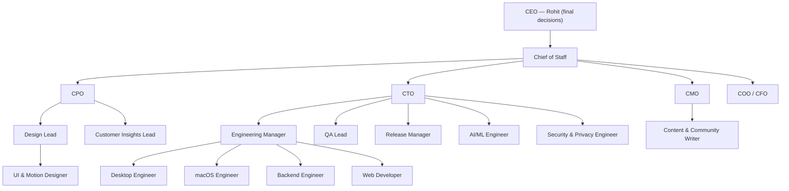

# Little Smoke Studio — Org chart

| Role | Level | Reports to | Agent file |
|---|---|---|---|
| Chief of Staff | C-suite | CEO (Rohit) | `company/agents/chief-of-staff.md` |
| Chief Product Officer | C-suite | CEO (Rohit) | `company/agents/cpo.md` |
| Chief Technology Officer | C-suite | CEO (Rohit) | `company/agents/cto.md` |
| Chief Marketing Officer | C-suite | CEO (Rohit) | `company/agents/cmo.md` |
| Chief Operating & Finance Officer | C-suite | CEO (Rohit) | `company/agents/coo.md` |
| Engineering Manager | Manager | CTO | `company/agents/engineering-manager.md` |
| Design Lead | Manager | CPO | `company/agents/design-lead.md` |
| QA Lead | Manager | CTO | `company/agents/qa-lead.md` |
| Release Manager | Manager | CTO | `company/agents/release-manager.md` |
| Customer Insights Lead | Manager | CPO | `company/agents/customer-insights-lead.md` |
| Senior Desktop Engineer (Windows/Electron) | IC | Engineering Manager | `company/agents/desktop-engineer.md` |
| macOS Engineer | IC | Engineering Manager | `company/agents/mac-engineer.md` |
| AI/ML Engineer | IC | CTO | `company/agents/ai-engineer.md` |
| Backend Engineer | IC | Engineering Manager | `company/agents/backend-engineer.md` |
| Web Developer | IC | Engineering Manager | `company/agents/web-developer.md` |
| UI & Motion Designer | IC | Design Lead | `company/agents/ui-designer.md` |
| Security & Privacy Engineer | IC | CTO | `company/agents/security-privacy-engineer.md` |
| Content & Community Writer | IC | CMO | `company/agents/content-writer.md` |

## Routines (IST)

| Routine | When | Led by | Output |
|---|---|---|---|
| Daily standup | Every day 06:47 | Chief of Staff | Daily brief in HQ repo, triage, ready queue, approvals applied |
| Dev cycle | 10:17, 14:17, 18:17, 22:17, 02:17 | Engineering Manager + engineer | One PR to `develop` per cycle |
| PR review | On every PR to `develop` | QA Lead + Security & Privacy | Job 1 `company-security-verdict` (review); job 2 `company-pr-route` (merge or route after job 1 completes) |
| Weekly exec meeting | Monday 07:47 | Chief of Staff with CPO, CTO, CMO, COO | Weekly report in HQ repo, roadmap update, next week's issues |
| Release | Thursday 11:47 | Release Manager + CTO | Release PR to `main`, changelog, Store checklist, sync PR to `develop` for your `/approve` |
| CEO commands | When the CEO comments | — (no AI) | `/approve`, `/reject`, `/change`, `/pause`, `/resume` |
| LinkedIn autopilot | Tue/Thu 09:07 + releases | CMO's pipeline | Posts that pass the quality gates |
